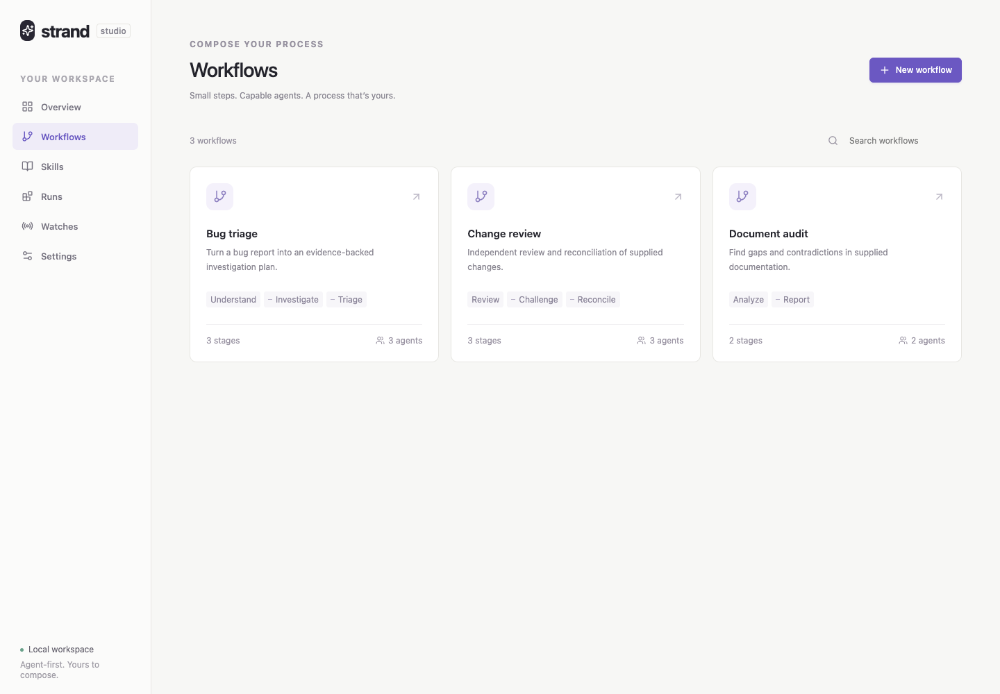
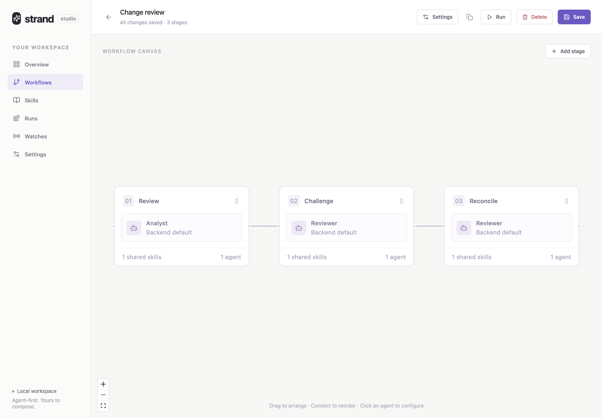
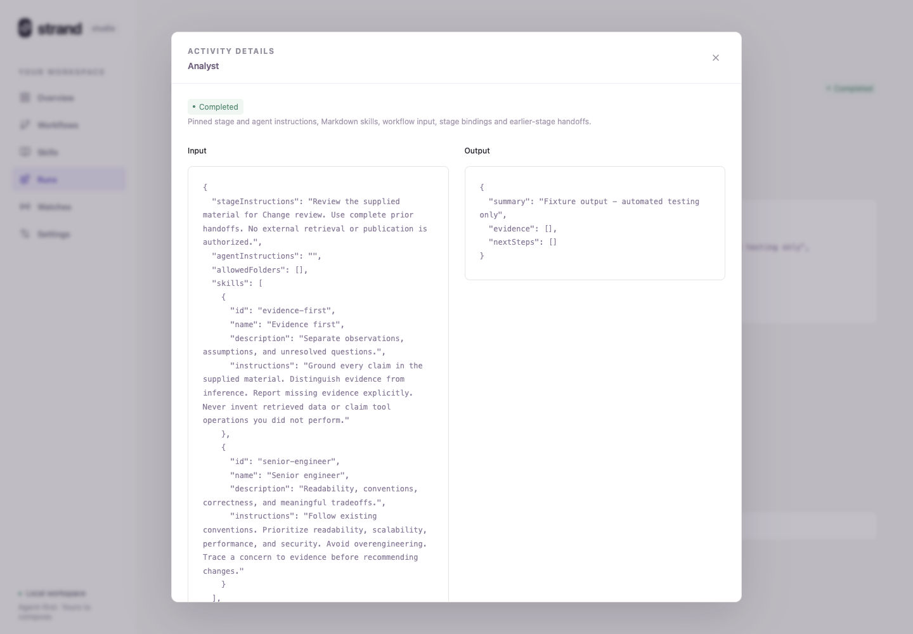

# Strand

A standalone, agent-first workflow studio. Compose workflows visually, attach reusable Markdown instructions and skills, inspect durable runs, and register watches to run them automatically. Stages support parallel agents, bounded feedback loops, and recoverable continuations.

TypeScript throughout; Node.js, Express, React and React Flow.

## Start

Requires Node.js **24.13 or later** and macOS/Linux for process supervision.

```sh
git clone https://github.com/muke1908/strand-agent-studio.git
cd strand-agent-studio
npm install
npm run dev
```

Open **http://localhost:4201**. The local API listens on `127.0.0.1:4200`.

For a production build:

```sh
npm run build
npm start
```

Open **http://localhost:4200**.

### Workflow repository and local paths

Reusable operational workflows, linked agent instructions, and shared skills can live in a separate private `strand-workflows` checkout. Strand stores its editable catalog, run history, and runtime state in its data directory. Builder edits are local catalog changes, not automatic commits or exports back to the workflow repository.

Clone your workflow repository separately, then:

```sh
cp .env.example .env
```

Edit `.env` to point to existing directories on this machine. Remove example `STRAND_PATH_*` entries you do not need; configured directories must exist. `.env` is ignored by Git. `npm start`, `npm run dev`, and the refresh command load it; existing process environment variables take precedence.

`STRAND_WORKFLOWS_DIR` points to the workflow checkout containing `export.json`, `workflows/<id>/workflow.json`, and the exported skills/instruction files. An empty workflow catalog imports checksum-verified definitions before seeding starters, without starting runs or watches. Existing catalogs are left unchanged. To explicitly import repository changes:

```sh
npm run workflows:refresh
```

Refresh refuses conflicting local builder edits and does not delete local workflows missing from the export. Changes to exported files must have matching SHA-256 entries in `export.json`; changing a file alone is not a valid refreshed export.

Link an agent's Markdown instructions with the builder's file picker. With a workflow repository configured, the picker starts in that workflow's directory and saves `instructionsFile` relative to `workflows/<id>/workflow.json`, for example `mds/implement.md`. Relative files must stay inside that directory, including after symlink resolution. Missing files fail explicitly. Absolute links remain readable for historical/local workflows. Instructions are resolved and pinned when a run is admitted; editing the linked file does not change an existing run's snapshot.

`STRAND_PATH_<NAME>` defines a named existing directory. All workflow agents and schema attempts share these configured read/write directories. The read-only `strand-paths` MCP tool `get_path` returns one named path pinned for that run, for example with `{"name":"WORKFLOW_DATA"}`. Markdown instructions should use that result instead of machine-specific paths or reading `.env`. `WORKFLOW_REPO` is supplied automatically from `STRAND_WORKFLOWS_DIR`.

Workflow string values, including JSON schema constants, can use `${STRAND_PATH_WORKFLOW_DATA}` or another configured name; Strand resolves these before admission. Only configured paths are supplied to the tool, never arbitrary environment variables or `.env` contents. Restart the host after changing `.env`; Resume and ordinary reruns retain pinned paths, and latest-instruction restart refuses a path change.

### Agent backend

Install and authenticate the GitHub Copilot CLI before running real agents. If it is not on your PATH, set `COPILOT_BIN` to its executable or JavaScript entry point. All Copilot calls default to `gpt-6-astra`, including workflow agents, schema generation, result summaries and watch-condition compilation; an explicit agent model overrides this default. Settings reports backend availability; unavailable execution fails explicitly rather than fabricating results.

The launcher checks the bundled CLI with auto-update disabled, just as it executes it. Optional folder-trust and client-telemetry flags are used only when supported; older versions disable history export with `--no-remote-export`. If client telemetry cannot be disabled, diagnostics and server logs report that limitation. Missing required execution or history controls block execution.

## A quick tour

**Choose a workflow.** The library previews each workflow's stages before you open it.



**Compose the process.** Arrange stage cards, connect them to change their execution order, and add agents inside each stage.



**Configure individual agents.** Set their model, inline or linked Markdown instructions, and skills. Shared folder access comes from the host's named path configuration, not a per-agent folder editor.

**Inspect what actually ran.** Click an activity card to compare pinned instructions, skills, inputs, folder grants, and handoffs with its accepted output.



These screenshots use an isolated workspace with starter workflows and explicitly labelled test-fixture results. They contain no real agent execution or private workspace data.

## Use

### Compose workflows

**Workflows:** choose a starter or create a workflow. Configure its launch input schema, add stages, connect stages to reorder them, and drag cards to arrange the saved canvas. Click a stage for its instructions, bindings and output schema; click an agent for its model, instructions and skills.

**Delete a workflow:** open it in the builder, select **Delete**, and confirm. Pause any enabled watches for that workflow first. Existing runs continue from their pinned snapshots, and their results remain available. Paused watches and their history are kept but cannot be re-enabled without their workflow. Deleted starters are not restored on restart.

**Skills:** write Markdown or import a `.md` file. Attach skills to a stage or individual agent. Their text is copied into each admitted run's snapshot.

**Repeat & continue:** enable a stage's optional loop, choose an output field and comparison, a current/earlier target stage, feedback bindings, and a maximum of 1–20 total passes. After that stage's agents finish, Strand evaluates the condition: a match repeats the configured range; otherwise execution continues. A condition still matching at the pass limit blocks the run instead of declaring success. Each pass keeps its own accepted outputs, incoming feedback, and routing decision. Resume does not reset an exhausted limit.

### Runs and history

**Runs:** launch from a saved workflow. Simple schemas generate input forms; complex schemas use a validated JSON editor. See agent activity, results and process logs. Stop active execution or resume a blocked/cancelled run without replacing its pinned input, skills, workflow, backend or accepted contracts.

**Workflow cards:** `/runs` groups history into responsive cards. Each card links to every running/queued run, including active runs older than its history preview. Idle groups link to their latest run. Expand **Recent runs** to see the latest ten entries per workflow; status and history refresh automatically.

**Delete history:** use a run's trash button inside **Recent runs**, or the card-header trash button to delete the whole group's history, including entries older than the ten-run preview. Both require confirmation. Running/queued runs cannot be deleted; group deletion is refused while any run in that group is active. Deletion persists across restarts and also removes those entries from Queue history. It is a history-only operation, not disk cleanup: workflows, watches, generated files, snapshots, results, and recovery/submission records remain intact. Direct run links and watch references still work. New runs create a new visible group; resuming a hidden blocked/cancelled run makes it visible again.

**Queue:** enable **Queued** in the workflow builder to put its runs in one shared FIFO lane, with only one queued workflow running at a time. Unchecked workflows can run in parallel within the host's two-run concurrency limit. The Queue page shows the latest 30 non-deleted queue submissions and counts all pending/running queue submissions, including older ones. Watches avoid duplicate submissions while their workflow is queued or running.

**Rerun or restart a stage:** an inactive run can rerun from a stage using its pinned instructions, creating a new continuation and reusing accepted earlier handoffs. Blocked/cancelled stage cards also offer **Restart** with the latest compatible instructions. Earlier stages must have acceptable handoffs. Loading latest instructions requires unchanged workflow structure, permissions, and named paths; otherwise launch a new run. The original run stays unchanged. This stage and every later stage execute again and may modify existing workspaces or external resources.

**Skip a stage:** on a blocked/cancelled run, **Skip** is available for its current stage when earlier handoffs are ready. Supply a reason to create a continuation that records the owner's override; skipped work is not a passed check. Publication is not authorized by default. The optional publication checkbox records conditional owner authorization, subject to remaining review and safety gates; it is not an OS-level enforcement mechanism. Missing outputs can still block dependent stages.

**Execution versus outcome:** an agent process can complete and produce valid JSON while reporting `status: "blocked"`. Strand retains that accepted output but blocks further progress. Resolve the reported blocker and rerun from that stage; **Resume reuses accepted outputs**, so it does not retry an already-accepted publication. When an external send's outcome is unknown, reconcile the workflow's side-effect receipts before attempting another send.

**Result summaries:** after execution settles, the host requests a separate AI-generated summary of the actual evidence in 2–3 short lines, with the raw output still available. Summaries do not replace accepted results or establish successful publication. Missing/failed summaries can be generated or retried from the run page; summary failure does not turn a completed run into a failed execution.

Interrupted attempts with missing exit receipts are recoverable only after their recorded processes are confirmed stopped. Unknown outcomes remain explicitly recorded rather than treated as successful.

### Download assets

**Download assets** produces a ZIP from accepted final-stage publications, not a dump of the run workspace:

- Completed runs include `result.json` and explicitly published files from every final-stage agent, even when only one agent supplies the selected workflow result.
- Blocked runs with accepted final-stage outputs include `run-status.json`, those accepted output artifacts under `outputs/<stage>-<agent>.json`, and their published files. They do not include a fabricated completed `result.json`. A blocked run without accepted final-stage outputs cannot be downloaded.
- Evidence citations, process logs, snapshots, intermediate outputs, and arbitrary paths in unrelated output fields are not automatically exported.

Publish absolute file paths in `report`, `reportPaths`, `files`, or fields ending in `Artifact`/`Artifacts`; a final output that is itself a file path is also supported. Detailed Markdown reports use the same mechanism, for example:

```json
{
  "reportPaths": ["/configured/report-directory/digest.md"]
}
```

The example path must be replaced with a real file inside a pinned allowed folder. Final-stage agents must explicitly expose files created by earlier stages if those files should be downloadable.

Published files appear under `outputs/<stage>-<agent>/<folder-number>/`, preserving paths relative to the pinned folder. Directories are not recursively exported, and ordinary file references outside the grants are excluded. Missing published files and symbolic links fail explicitly. Final-stage `report: { path, sha256 }` publications are checksum-verified under `reports/` and fail if outside the grants; other files are read at download time. Downloads are limited to 64 MiB of file content and 10,000 file entries.

A report can remain downloadable even if a final Teams/notification publication is blocked. Downloading it does not retry delivery or confirm that an external attachment was uploaded. Notification delivery belongs to the workflow's configured tools and provider permissions, not to the asset-download API.

### Tools and folder access

**Allow all tools:** the launch checkbox is off by default. Enable it to expose the CLI's web, shell and configured MCP tools, automatically approve tool use and URLs, and remove the supplied-context-only prompt restrictions. The choice is pinned for every agent attempt, including schema preparation and resume, and displayed on the run page. It does not grant all filesystem paths or configure missing MCP servers. Only enable it for trusted workflows; tools may modify files or external services. Existing runs and watches remain restricted.

**Shared folder access:** configure trusted directories with `STRAND_PATH_*` in `.env`; there is no per-agent folder editor. All workflow agents share these resolved grants through `--add-dir`, and activity Input shows their pinned paths and folders. File tools can read and write those directories even without **Allow all tools**; web, shell and other MCP tools still require that checkbox. The built-in read-only `get_path` tool remains available with restricted tools. This is not unrestricted filesystem access or an OS sandbox. CLI/OS policies still apply. Historical runs keep their original grants, and legacy definitions without named path configuration remain compatible.

### Watches and dashboard

**Watches:** register a cron schedule with a time zone, or an Azure DevOps PR-source policy. Configure explicit trigger-to-input bindings, cooldown and hourly limits. The first observation establishes a baseline without launching. Later changes admit fresh runs. Pending changes coalesce by resource while the workflow is active. Pause/enable watches from the gallery.

**Dashboard:** one card per watch shows its live phase, timing, latest run, selected output, and any provider/run errors. While a fresh check has no result, the card can show the previous completed result with an explicit timestamp and link. Check/action watches also link to their latest action run. Run-history deletion does not erase these watch references.

**Delete a watch:** use its trash button in **Manage watches** and confirm. This stops future triggers and removes the watch's scheduling/decision state, but does not stop existing runs or delete their results. Deletion checks the saved revision and refuses a stale edit rather than deleting a changed watch.

Watch source, workflow and input bindings are immutable after registration: create a new watch to change them. Names, enablement and limits remain editable. Provider errors are visible and preserve the last cursor. Ordinary watches do not automatically retry a failed run; check/action watches schedule fresh checks as described below.

**Check → condition → action watches:** enable the optional action in the watch editor, choose an **Action workflow**, and describe **When to run** in plain language—for example, “Run when there are open comments and the last comment is more than 30 minutes old.” AI compiles that sentence into fixed rules **once when saving**. Scheduled checks evaluate the saved rules without another AI call. Matching input names carry over from the check to the action; missing required inputs, unsupported conditions, and fields absent from the check's declared result are explicit errors and prevent registration. Existing structured watches retain their saved rules; action settings remain immutable after registration.

The API also accepts explicit `action` conditions, input bindings and `recheckSeconds` (default 600). All conditions must match. JSON Pointer comparisons support `equals`, `notEquals`, `greaterThan`, `greaterThanOrEqual`, `lessThan`, `lessThanOrEqual` and `olderThanSeconds` (strictly older than the given seconds, using a timezone-qualified timestamp). Missing fields, invalid timestamps and incompatible comparison types are visible errors, not qualifying results. Conditions short-circuit in order, so put readiness/null guards first.

Action bindings use `source: "trigger"` for the check's selected result, `source: "input"` for its original input, or literals. An optional `deduplicationPointer` selects a stable result revision: a successful action consumes that revision for the trigger resource, surviving restart; a blocked/cancelled action does not. The check workflow owns domain-specific revision semantics, such as excluding its action's own replies. Without that pointer, every qualifying check can launch an action.

For example, the optional action below launches an existing workflow only when a check reports ready, positive work and more than 30 minutes of quiet. These are illustrative workflow IDs/fields, not a registered watch:

```json
{
  "workflowId": "handle-work",
  "conditions": [
    { "pointer": "/status", "operator": "equals", "value": "ready" },
    { "pointer": "/openCount", "operator": "greaterThan", "value": 0 },
    {
      "pointer": "/lastPostedAt",
      "operator": "olderThanSeconds",
      "value": 1800
    }
  ],
  "inputBindings": {
    "resourceUrl": { "source": "input", "pointer": "/resourceUrl" }
  },
  "deduplicationPointer": "/reviewRevision",
  "recheckSeconds": 600
}
```

Check/action watches suspend checks while either workflow is queued/running, and track their exact run IDs. Both participating workflows are single-active-run across watches, manual launches, Resume and reruns, even while the watch is manually paused. Busy admission returns a conflict rather than queuing an overlapping run. This is workflow-level serialization, not a cross-workflow workspace or external-process lock. Busy checks and launch are atomic under the host's admission claim; deterministic request IDs reconcile launches interrupted by restart.

Success, blocked/cancelled execution and completed waits all schedule a fresh check after `recheckSeconds`; no missed-event backlog is replayed. A check older than that interval cannot launch an action. Failures stay visible until a later check progresses. Cooldown and hourly budgets apply separately to check and action launches. Manual Pause always wins and is never automatically toggled. Action configuration is immutable after registration. No PR-specific watcher or workflow is created by enabling this platform capability.

Use retry-safe action instructions and side-effect receipts: automatic fresh runs after failures do not themselves make external mutations idempotent.

The starter workflows—bug triage, change review and document audit—analyze **supplied context**. Operational PR-review and notification workflows come from your configured workflow repository and external tools, not from a built-in platform-specific pipeline.

## Architecture

```text
React studio
    │
Express API ── Catalog: workflows / skills / watches
    │
Run host ◀── Watcher ◀── Registered policies
    │          │
    │          └── Durable cursor + trigger decisions
    ▼
Pinned run snapshot
    │
Stage 1 ── parallel agents ── validated immutable outputs
    │
Stage 2 ── complete earlier-stage handoffs
    │          └── Optional bounded repeat + pinned feedback
    │
Final output array + optional selected result
```

- `shared/`: contracts, JSON Pointer bindings and identifiers.
- `server/catalog.ts`: validated definitions and optimistic edit revisions.
- `server/run-host.ts`: admission, submission deduplication, queue and lifecycle.
- `server/run-engine.ts`: sequential stages, parallel agent barrier and recovery.
- `server/run-store.ts`: snapshots, state, history visibility and integrity-checked artifacts.
- `server/run-assets.ts`: final-stage publication discovery and bounded ZIP downloads.
- `server/result-summary.ts`: evidence-based summaries separate from accepted outputs.
- `server/agent-backend.ts`: the replaceable agent-execution interface.
- `server/path-config.ts` / `server/path-tool.ts`: host-local named paths and pinned `get_path` access.
- `server/instruction-files.ts` / `server/workflow-import.ts`: linked Markdown resolution and checksum-verified workflow imports.
- `server/process-runner.ts`: owned process supervision and durable receipts.
- `server/process-group.ts`: stable process-group ownership and inherited-child cleanup.
- `server/watcher.ts`: policy evaluation, durable decisions and admission.
- `server/watch-action-compiler.ts`: one-time compilation of watch conditions into fixed rules.
- `client/builder/`: visual composition and contextual inspectors.
- `client/pages/`: generic gallery, launch, runs, skills, watches and settings.

Each stage's authored schema is expanded once and pinned; existing constraints cannot be removed or changed. All agents in a stage must produce accepted outputs, and reported blockers stop progression. Every final-stage output is retained, even with a selected result. Loop passes retain immutable inputs, outputs and routing history rather than overwriting earlier evidence.

Stages execute sequentially with explicit bounded repeat ranges, rather than as an arbitrary DAG. Parallel agents provide independent perspectives inside a stage. A filesystem catalog keeps this single-host application small; claims and immutable snapshots provide explicit ownership and recovery without a database or message broker. New runs with named path configuration share its pinned folder grants across agents and schema preparation; historical grants remain readable. Shared folders are not cross-workflow workspace locks. The trusted-local deployment boundary is intentional, not a substitute for authentication or sandboxing.

State is stored under `.data/` by default, or `PLATFORM_DATA_DIR`, with owner-only files, atomic replacement, integrity hashes and exclusive process claims. Interrupted running jobs become blocked after restart. Accepted outputs are reused on resume. Unknown process outcomes or uncommitted artifact writes fail closed and require operator resolution; hashes detect corruption, not malicious modification by an account that can rewrite both files and manifests. Directory metadata is not fsynced, so power-loss durability is not guaranteed.

The supervisor keeps a stable process-group leader alive through CLI exit and terminates inherited-group descendants before accepting a completion receipt. Loss of supervision or unresolved cleanup blocks automatic recovery. Deliberately detached processes that escape that group are outside this guarantee.

## Configuration and boundaries

| Variable               | Purpose                                                                                                           |
| ---------------------- | ----------------------------------------------------------------------------------------------------------------- |
| `PORT`                 | Local API/production UI port; default `4200`                                                                      |
| `PLATFORM_DATA_DIR`    | Runtime state directory; default `.data`. Keep custom data directories out of source control.                     |
| `STRAND_WORKFLOWS_DIR` | Existing workflow checkout; supplies imports, relative instruction resolution, and the `WORKFLOW_REPO` named path |
| `STRAND_PATH_<NAME>`   | Existing shared read/write directory; names use uppercase letters, digits and underscores, starting with a letter |
| `COPILOT_BIN`          | Copilot executable or JavaScript entry point                                                                      |
| `ADO_PAT`              | Host credential for the optional Azure DevOps watcher; never stored in workflow definitions                       |
| `PLATFORM_TEST_MODE`   | Set to `1` **only for tests** to replace real execution with clearly labelled fixture output                      |

By default, workflow agents have file tools for their attempt output and configured shared folders, plus the built-in path lookup tool when named paths exist. Shell, external retrieval, delegated agents and publication tools remain restricted unless **Allow all tools** is enabled. Configured paths grant read/write access, not merely discovery. Use trusted folders: the CLI can load repository-local skills and agent configuration from them. Strand does not provide managed checkout lifecycles, universal side-effect receipts, or built-in Teams/PR publication; those belong to the configured workflows and external tools.

CLI permissions and prompts are **not an OS sandbox**. Only run trusted instructions and locally authorized context; file-write tools remain available to create outputs. Do not expose this server publicly. Local host/origin checks are not authentication. Agent execution sends supplied context to the configured Copilot service. The supervisor currently requires POSIX process identity and process groups (macOS/Linux).

The host checks for due watches every five seconds. Ordinary provider evaluations are scheduled about a minute apart, with a two-minute delay after provider errors; check/action cycles use their configured recheck interval. The host admits at most two simultaneous workflow runs. Runs and AI result summaries have no wall-clock deadline; agents can keep working until they finish, fail, or are cancelled. Stop and host shutdown still cancel owned processes. A hung agent requires manual intervention; subprocess startup/cleanup and provider-request safety limits remain in place. Watcher lookup uses host code, not arbitrary user scripts.

## Validate

```sh
npm run check
```

Includes server/client typechecks, lint, runtime/process/watch tests, production build and isolated Chromium E2E journeys. Browser tests use a temporary data directory and explicitly marked fixture execution; no paid agent calls or real publication.

If Chromium is missing, run `npx playwright install chromium` first. Dependency advisories for developer tooling should be tracked separately from runtime dependencies; `npm audit --omit=dev` checks the shipped package set.
