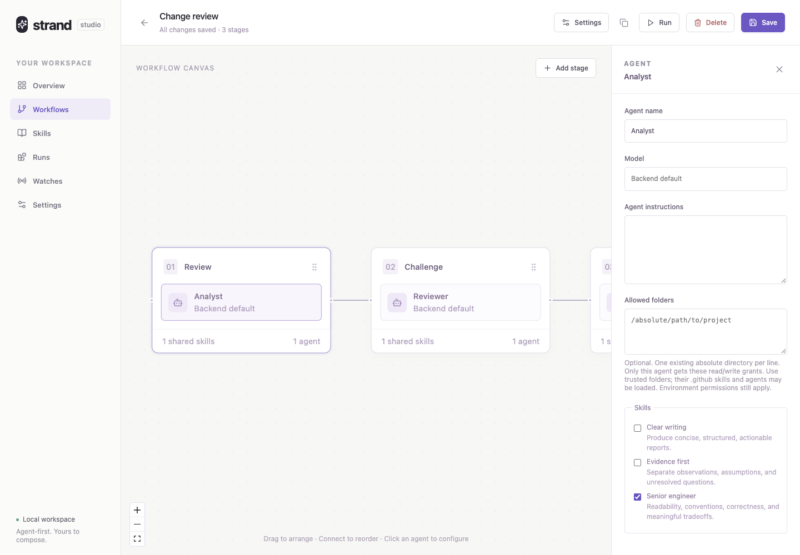

# Strand

A standalone, agent-first workflow studio. A strand connects small stages into a complete process: compose a workflow visually, attach reusable Markdown skills, launch a run, and register a policy to run it again.

TypeScript throughout; Node.js, Express, React and React Flow. No dependency on the existing PR-review application.

## Start

Requires Node.js **24.13 or later**.

```sh
git clone https://github.com/muke1908/strand-agent-studio.git
cd strand-agent-studio
npm install
npm run dev
```

Open **http://localhost:4201**. The local API listens on `127.0.0.1:4200`.

For a production build:

```sh
npm run build
npm start
```

Open **http://localhost:4200**.

Install and authenticate the GitHub Copilot CLI before running real agents. If it is not on your PATH, set `COPILOT_BIN` to its executable or JavaScript entry point. Settings reports backend availability; unavailable execution fails explicitly rather than fabricating results.

The launcher checks the bundled CLI with auto-update disabled, just as it executes it. Optional folder-trust and client-telemetry flags are used only when supported; older versions disable history export with `--no-remote-export`. If client telemetry cannot be disabled, diagnostics and server logs report that limitation. Missing required execution or history controls block execution.

## A quick tour

**Choose a workflow.** The library previews each workflow's stages before you open it.


**Compose the process.** Arrange stage cards, connect them to change their execution order, and add agents inside each stage.


**Configure individual agents.** Set their model, instructions, Markdown skills, and optional folder access independently.



**Inspect what actually ran.** Click an activity card to compare pinned instructions, skills, inputs, folder grants, and handoffs with its accepted output.


These screenshots use an isolated workspace with starter workflows and explicitly labelled test-fixture results. They contain no real agent execution or private workspace data.

## Use

**Workflows:** choose a starter or create a workflow. Configure its launch input schema, add stages, connect stages to reorder them, and drag cards to arrange the saved canvas. Click a stage for its instructions, bindings and output schema; click an agent for its model, instructions and skills.

**Delete a workflow:** open it in the builder, select **Delete**, and confirm. Pause any enabled watches for that workflow first. Existing runs continue from their pinned snapshots, and their results remain available. Paused watches and their history are kept but cannot be re-enabled without their workflow. Deleted starters are not restored on restart.

**Skills:** write Markdown or import a `.md` file. Attach skills to a stage or individual agent. Their text is copied into each admitted run's snapshot.

**Runs:** launch from a saved workflow. Simple schemas generate input forms; complex schemas use a validated JSON editor. See agent activity, results and process logs. Stop active execution or resume a blocked/cancelled run without replacing its pinned input, skills, workflow, backend or accepted contracts.

**Allow all tools:** the launch checkbox is off by default. Enable it to expose the CLI's web, shell and configured MCP tools, automatically approve tool use and URLs, and remove the supplied-context-only prompt restrictions. The choice is pinned for every agent attempt, including schema preparation and resume, and displayed on the run page. It does not grant all filesystem paths or configure missing MCP servers. Only enable it for trusted workflows; tools may modify files or external services. Existing runs and watches remain restricted.

**Allowed folders:** select an individual agent in the workflow builder and enter existing absolute directory paths, one per line. Strand resolves symlinks, removes duplicates, saves the grants in that agent's configuration, and pins them when a run starts. Only that agent's Copilot subprocess receives its grants via `--add-dir`; other agents and schema preparation do not inherit them. Resumed attempts keep their original permissions. Inspect an activity card's Input to see its pinned folders. File tools may read and modify granted folders even without **Allow all tools**; shell and network tools still require that checkbox. Use trusted folders only: Copilot may load their `.github/skills` and `.github/agents` as trusted configuration. OS and managed CLI policies still apply. Leaving an agent's field empty adds no grants. Watches use the saved per-agent permissions for fresh runs. Historical runs retain their original run-wide grants; new launches cannot request run-wide folder access.

**Watches:** register a cron schedule with a time zone, or an Azure DevOps PR-source policy. Configure explicit trigger-to-input bindings, cooldown and hourly limits. The first observation establishes a baseline without launching. Later changes admit fresh runs. Pending changes coalesce by resource while the workflow is active. Pause/enable watches from the gallery.

Watch source, workflow and input bindings are immutable after registration: create a new watch to change them. Names, enablement and limits remain editable. Provider errors are visible and preserve the last cursor. There is no automatic failed-run retry loop.

The starter workflows—bug triage, change review and document audit—analyze **supplied context**. They do not retrieve issues or implement the previous application's operational PR-review flow.

## Architecture

```text
React studio
    │
Express API ── Catalog: workflows / skills / watches
    │
Run host ◀── Watcher ◀── Registered policies
    │          │
    │          └── Durable cursor + trigger decisions
    ▼
Pinned run snapshot
    │
Stage 1 ── parallel agents ── validated immutable outputs
    │
Stage 2 ── complete earlier-stage handoffs
    │
Final output array + optional selected result
```

- `shared/`: contracts, JSON Pointer bindings and identifiers.
- `server/catalog.ts`: validated definitions and optimistic edit revisions.
- `server/run-host.ts`: admission, submission deduplication, queue and lifecycle.
- `server/run-engine.ts`: sequential stages, parallel agent barrier and recovery.
- `server/run-store.ts`: snapshots, state and integrity-checked artifacts.
- `server/agent-backend.ts`: the replaceable agent-execution interface.
- `server/process-runner.ts`: owned process supervision and durable receipts.
- `server/process-group.ts`: stable process-group ownership and inherited-child cleanup.
- `server/watcher.ts`: policy evaluation, durable decisions and admission.
- `client/builder/`: visual composition and contextual inspectors.
- `client/pages/`: generic gallery, launch, runs, skills, watches and settings.

Each stage's authored schema is expanded once and pinned; existing constraints cannot be removed or changed. All agents in a stage must succeed before the next stage starts. Every final-stage output is retained, even with a selected result.

Stages are deliberately sequential rather than an arbitrary DAG: execution order and handoffs stay easy to inspect, while parallel agents provide independent perspectives inside a stage. A filesystem catalog keeps this single-host application small; claims and immutable snapshots provide explicit ownership and recovery without a database or message broker. Folder grants belong to individual agents, not their workflow peers. The trusted-local deployment boundary is intentional, not a substitute for authentication or sandboxing.

State is stored under `.data/` with owner-only files, atomic replacement, integrity hashes and exclusive process claims. Interrupted running jobs become blocked after restart. Accepted outputs are reused on resume. Unknown process outcomes or uncommitted artifact writes fail closed and require operator resolution; hashes detect corruption, not malicious modification by an account that can rewrite both files and manifests. Directory metadata is not fsynced, so power-loss durability is not guaranteed.

The supervisor keeps a stable process-group leader alive through CLI exit and terminates inherited-group descendants before accepting a completion receipt. Loss of supervision or unresolved cleanup blocks automatic recovery. Deliberately detached processes that escape that group are outside this guarantee.

## Configuration and boundaries

| Variable               | Purpose                                                                                     |
| ---------------------- | ------------------------------------------------------------------------------------------- |
| `PORT`                 | Local API/production UI port; default `4200`                                                |
| `PLATFORM_DATA_DIR`    | State directory; default `.data`                                                            |
| `COPILOT_BIN`          | Copilot executable or JavaScript entry point                                                |
| `ADO_PAT`              | Host credential for the optional Azure DevOps watcher; never stored in workflow definitions |
| `PLATFORM_TEST_MODE=1` | **Tests only:** replaces real execution with clearly labelled fixture output                |

This initial project is a **local execution foundation**, not a complete deployment of the larger platform specification. By default, agent attempts have file tools for their own output, but no shell, external retrieval, delegated agents or publication tools. The launch-time **Allow all tools** option lifts those tool restrictions, and each agent's **Allowed folders** grants additional file access. Managed checkout lifecycles, trusted effect receipts, a dedicated PR-creation workflow and migration of the old Review pipeline are not implemented.

CLI permissions and prompts are **not an OS sandbox**. Only run trusted instructions and locally authorized context; file-write tools remain available to create outputs. Do not expose this server publicly. Local host/origin checks are not authentication. Agent execution sends supplied context to the configured Copilot service. The supervisor currently requires POSIX process identity and process groups (macOS/Linux).

Watches poll every minute, with a longer delay after provider errors. The host admits at most two simultaneous runs and bounds each run to 30 minutes. Watcher lookup uses host code, not arbitrary user scripts.

## Validate

```sh
npm run check
```

Includes server/client typechecks, lint, runtime/process/watch tests, production build and isolated Chromium E2E journeys. Browser tests use a temporary data directory and explicitly marked fixture execution; no paid agent calls or real publication.

If Chromium is missing, run `npx playwright install chromium` first. Dependency advisories for developer tooling should be tracked separately from runtime dependencies; `npm audit --omit=dev` checks the shipped package set.
